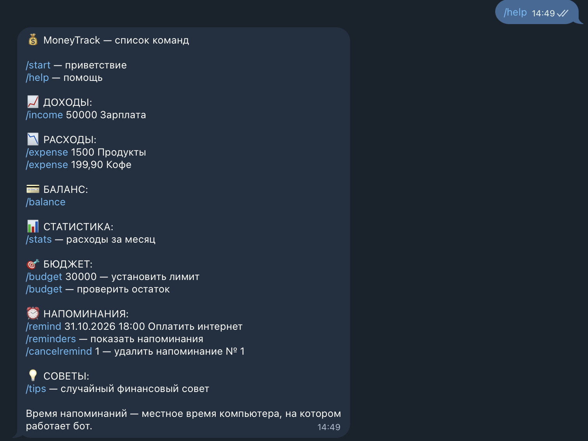
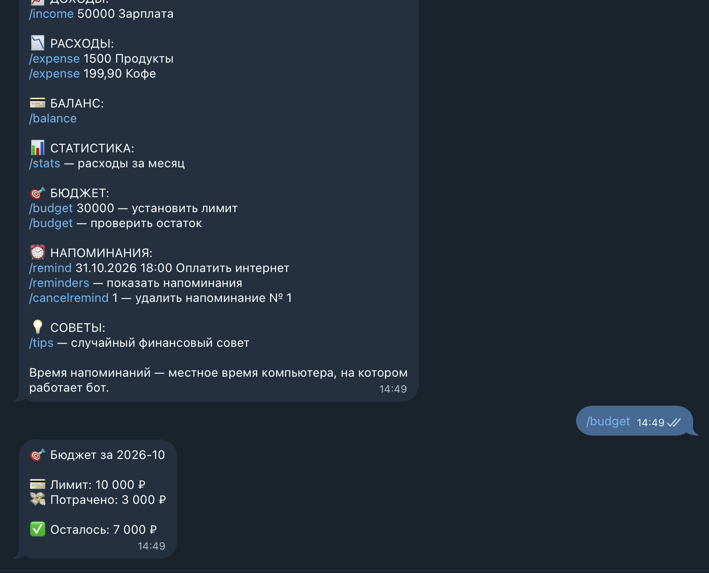

# Практическая работа № 2 — Создание Telegram Bot

## MoneyTrack — Финансовый помощник

**Автор:** Рябов Максим Алексеевич  
**Группа:** ПИ25-3  
**Дисциплина:** Практикум по программированию  
**Тема:** № 2 — Финансовый помощник

**Telegram-бот:** [@maksim_moneytrack_bot](https://t.me/maksim_moneytrack_bot)

## Описание проекта

MoneyTrack — Telegram-бот для учёта личных финансов.

Программа позволяет пользователям записывать доходы и
расходы, отслеживать баланс, контролировать месячный
бюджет, получать статистику расходов и создавать
напоминания о платежах.

Бот разработан на Python с использованием библиотеки
python-telegram-bot и базы данных SQLite.

## Возможности

- Учёт доходов и расходов.
- Разделение операций по категориям.
- Подсчёт общего финансового баланса.
- Статистика расходов за текущий месяц.
- Установка месячного бюджета.
- Контроль превышения бюджета.
- Создание напоминаний о платежах.
- Просмотр и удаление напоминаний.
- Случайные советы по управлению финансами.
- Раздельное хранение данных пользователей.
- Сохранение информации после перезапуска бота.

## Команды Telegram

| Команда | Назначение |
|---|---|
| `/start` | Приветствие |
| `/help` | Список команд |
| `/income 50000 Зарплата` | Добавить доход |
| `/expense 1500 Продукты` | Добавить расход |
| `/balance` | Показать баланс |
| `/stats` | Статистика расходов |
| `/budget 30000` | Установить месячный бюджет |
| `/budget` | Проверить остаток бюджета |
| `/remind ДД.ММ.ГГГГ ЧЧ:ММ Описание` | Создать напоминание |
| `/reminders` | Список напоминаний |
| `/cancelremind 1` | Удалить напоминание № 1 |
| `/tips` | Финансовый совет |

## Используемые технологии

- Python 3.9+
- python-telegram-bot 22.5
- Telegram Bot API
- SQLite
- unittest
- logging

## Установка и запуск

### 1. Клонировать репозиторий

```bash
git clone https://github.com/Framyrite/ppp_lab3.2_telegram_bot.git
cd ppp_lab3.2_telegram_bot
```

### 2. Создать виртуальное окружение

```bash
python3 -m venv venv
```

### 3. Активировать окружение

Для macOS и Linux:

```bash
source venv/bin/activate
```

### 4. Установить зависимости

```bash
python -m pip install -r requirements.txt
```

### 5. Настроить Telegram-токен

Создать локальный конфигурационный файл:

```bash
cp config.example.py config.py
```

Получить токен у [@BotFather](https://t.me/BotFather).

В файле `config.py` указать:

```python
BOT_TOKEN = "ВАШ_ТОКЕН_ОТ_BOTFATHER"
```

Файл `config.py` исключён из Git и не должен
публиковаться в репозитории.

### 6. Запустить бота

```bash
python bot.py
```

Открыть Telegram-бота:

https://t.me/maksim_moneytrack_bot

Для остановки программы нажать Ctrl + C.

## Хранение данных

Для хранения информации используется SQLite.

При запуске создаётся локальная база данных
`moneytrack.sqlite3`.

В базе содержатся три таблицы:

- `transactions` — доходы и расходы.
- `budgets` — месячные бюджеты пользователей.
- `reminders` — напоминания о платежах.

Каждая операция связана с Telegram ID пользователя.

Денежные суммы хранятся в целых копейках, что
позволяет избежать ошибок округления.

База данных и токен бота не публикуются на GitHub.

## Напоминания

Бот проверяет напоминания каждые 15 секунд.

Время напоминаний определяется часовым поясом
компьютера, на котором запущена программа.

Напоминания отправляются только при работающем боте.
После перезапуска сохранённые просроченные
напоминания проверяются и отправляются.

## Автоматическое тестирование

Для запуска тестов выполнить:

```bash
python -m unittest discover -s tests -v
```

Тесты проверяют:

- Добавление доходов и расходов.
- Расчёт баланса.
- Раздельное хранение данных пользователей.
- Статистику расходов.
- Создание и изменение бюджета.
- Добавление и удаление напоминаний.
- Обработку денежных сумм.

Для тестирования используются временные базы SQLite.

## Структура проекта

```text
ppp_lab3.2_telegram_bot/
├── bot.py
├── database.py
├── reminders.py
├── config.example.py
├── requirements.txt
├── README.md
├── .gitignore
├── screenshots/
│   ├── help.png
│   └── budget.png
└── tests/
    ├── __init__.py
    ├── test_database.py
    ├── test_money.py
    └── test_reminders.py
```

Локально также создаются `config.py`, `venv/`
и `moneytrack.sqlite3`.

## Скриншоты

### Список команд



### Контроль бюджета



## Результат работы

Разработан Telegram-бот MoneyTrack для управления
личными финансами. Реализованы основные функции
финансового помощника, хранение данных в SQLite,
напоминания о платежах и автоматические тесты.
